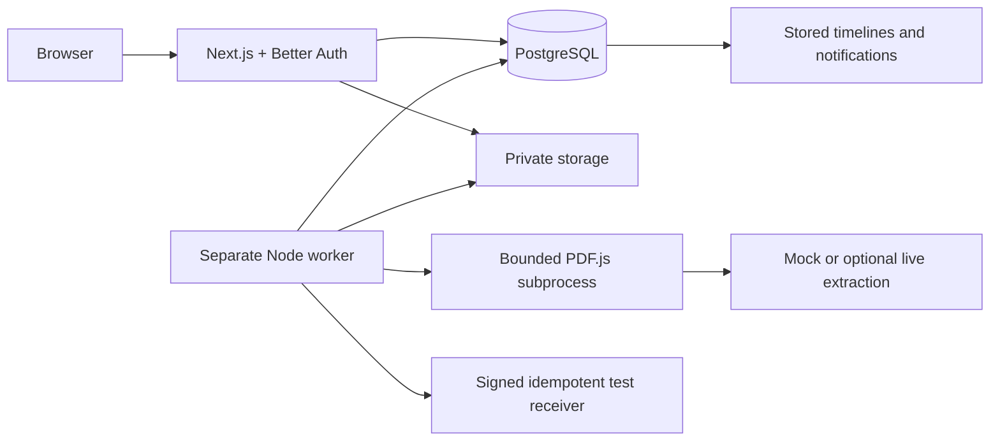

# Architecture

## Components
- Next.js 16 / TypeScript: public portfolio, sign-in, role workspace, protected JSON/multipart/file endpoints.
- Better Auth: password hashing, sessions and secure-cookie behavior on HTTPS. Public registration disabled.
- Prisma 7 + PostgreSQL adapter: versioned SQL migrations, transactions, constraints and row locks.
- PrivateStorage interface: local persistent filesystem implementation and hosted PostgreSQL BYTEA implementation, random keys and authenticated private routes. Hosted worker steps fetch the private bytes into a unique temporary file and remove it after parsing.
- Separate Node worker: polls durable Job and Outbox tables. Web requests enqueue work; no background promises perform the workflow.
- PDF.js 6 child process: bounded selectable-text parsing. Deterministic labelled parser or optional OpenAI structured-output provider.
- Signed controlled receiver: shared verification code powers both the private local dispatcher and the HTTP test endpoint.

Approval completion inserts Purchase, Notification and Outbox in one transaction. Delivery is at least once; receiver effects are idempotent by event ID. Job completion uses lease-token comparison, so stale workers cannot write final results. Human waiting states do not consume worker retries.

## Boundaries
The local web runtime cannot replace the dedicated worker. Hosted deployment uses Vercel Workflow to invoke the same persisted SQL worker through retryable Node steps, with durable sleeps and a daily authenticated recovery trigger. Uploads and approval decisions await durable dispatch, not completion. SQL leases, attempts and outbox remain the source of truth. Local files cannot be deployed onto an ephemeral serverless filesystem and called persistent storage. The hosted portfolio uses ordinary Neon PostgreSQL for data and private PDFs, HTTPS and private secrets. Shared production rate limiting and larger-scale storage are still beyond the verified portfolio scope.

Local PGlite exists for a no-account demonstration. Its timezone is explicitly UTC. Local pooling is constrained because its socket adapter is not ordinary multi-client PostgreSQL. No production concurrency claim follows from local tests.

## Official sources consulted
- [Prisma 7 transactions](https://www.prisma.io/docs/orm/v7/prisma-client/queries/transactions)
- [PostgreSQL queue-style SKIP LOCKED](https://www.postgresql.org/docs/current/sql-select.html)
- [Better Auth options](https://better-auth.com/docs/reference/options)
- [PDF.js examples and Node usage](https://mozilla.github.io/pdf.js/examples/)
- [OpenAI structured outputs](https://developers.openai.com/api/docs/guides/structured-outputs)

The UI/UX design search recommended a restrained navy, light background and clear operational hierarchy. No customer logos, sales claims or fabricated metrics were adopted from its generic landing-page suggestions.
